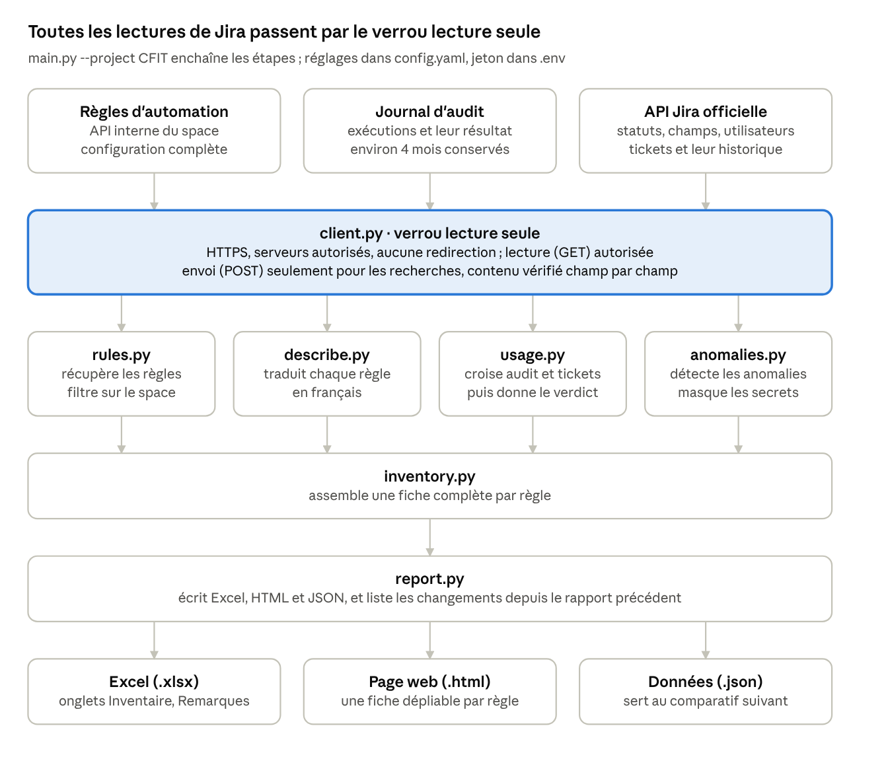

# POC — Inventaire automatique des automations Jira

19 octobre 2026 · Ilyaas ABDOUL AZIS

## Contexte et objectif

Ce POC produit, en une commande, l'inventaire complet des règles d'automation Jira d'un espace, avec la preuve que chaque règle sert encore. Il a été réalisé pendant mon alternance chez Cloudi-Fi, à la demande de mon responsable, sur l'espace Jira CFIT (Cloudi-Fi IT).

Le problème de départ : les règles d'automation s'accumulent dans Jira, créées par différentes personnes au fil du temps. Personne ne sait plus exactement ce que chacune fait, à qui elle appartient, ni si elle sert encore.

Pour chaque règle, l'inventaire devait donner :

- son nom, son statut (activée ou non) et son rôle expliqué simplement ;
- son auteur, son propriétaire et ses dates de création et de modification ;
- les personnes concernées ;
- une preuve d'utilisation ;
- des remarques sur les anomalies.

Contraintes posées dès le départ : le script doit être strictement en lecture seule, et le jeton d'accès ne doit jamais apparaître dans le code.

## Démarche et choix techniques

J'ai choisi un script Python lancé en local, pensé dès le départ pour pouvoir tourner plus tard en tâche planifiée. Trois solutions ont été comparées avant de coder :

| Solution | Avantages | Inconvénients | Retenue |
| --- | --- | --- | --- |
| Script Python en local | Rapide à mettre en place, facile à déboguer | Ne tourne que si mon PC est allumé | Oui, pour la V1 |
| Script Python lancé chaque semaine par GitHub Actions | Indépendant de mon poste, rapport historisé | Demande un dépôt et un compte de service | Plus tard |
| Google Apps Script + Google Sheets | Aucun serveur, tableur partagé | Limite de 6 minutes par exécution, peu testable | Non |

Le code respecte des règles qui permettront de passer en tâche planifiée sans réécriture :

- la configuration est dans un fichier `config.yaml` ;
- les secrets sont dans des variables d'environnement (fichier `.env` en local, jamais versionné) ;
- aucun chemin propre à Windows, aucune question posée à l'utilisateur ;
- un seul point d'entrée : `python main.py --project CFIT`.

Outils utilisés :

| Outil | Rôle |
| --- | --- |
| Python 3.12 | Langage du script |
| requests | Appels HTTP vers Jira |
| python-dotenv | Lecture du jeton dans `.env` |
| PyYAML | Lecture de la configuration |
| openpyxl | Génération du fichier Excel |
| Jinja2 | Génération de la page HTML |
| pytest | Tests automatiques |

## Obstacles rencontrés et solutions

Le principal obstacle a été un refus d'accès : je l'ai contourné sans demander de droits supplémentaires, en observant comment l'interface Jira elle-même récupère les données.

| Obstacle | Cause | Solution |
| --- | --- | --- |
| L'API officielle des automations répond « 403 accès refusé » | Atlassian la réserve aux administrateurs de tout Jira ; je suis administrateur de l'espace seulement | Utiliser l'adresse qu'utilise la page « Automation » de Jira, qui accepte les droits d'admin de l'espace |
| Trouver cette adresse | Elle n'est pas documentée | Outils de développement du navigateur (F12, onglet Réseau) : repérer la requête qui charge la liste des règles, son adresse et son contenu |
| Prouver qu'une règle sert alors qu'elle envoie seulement un email ou un webhook | Ces actions ne laissent aucune trace dans les tickets | Même méthode F12 sur l'onglet « Journal d'audit » : le script lit l'historique des exécutions |
| Une règle rare sortait de la fenêtre d'analyse | La fenêtre est de 90 jours ; la règle « Release process » a agi pour la dernière fois le 15/07 | Le rapport donne la date exacte de dernière action, la décision reste humaine |

Ce que j'en retiens : avant de demander plus de droits, il faut regarder comment l'outil fait lui-même. La limite de cette solution est qu'une adresse non documentée peut changer sans préavis.

## Fonctionnement du script

Le script lit trois sources dans Jira, toujours à travers le même verrou lecture seule, puis transforme ces données en un rapport.

Chaque fichier a un seul rôle : on peut ainsi modifier la traduction ou le calcul du verdict sans toucher au reste.

## Comment le script prouve qu'une règle sert encore

Le script croise deux sources indépendantes : le journal d'audit de Jira (les exécutions) et l'historique des tickets (les modifications réellement faites).

1. **Journal d'audit.** Chaque déclenchement d'une règle y est enregistré avec sa date et son résultat : « actions effectuées », « aucune action » (conditions non remplies) ou « erreur ». Jira conserve environ 4 mois d'historique.
2. **Historique des tickets.** Quand une règle agit, Jira l'enregistre au nom du robot « Automation for Jira ». Le script compare ces traces avec ce que chaque règle est censée faire : champ modifié, statut visé, personne assignée, titre des tickets créés, type de ticket. Il en tire des tickets d'exemple vérifiables à la main.

Chaque règle reçoit un verdict :

| Verdict | Règle appliquée |
| --- | --- |
| Active (prouvée) | Au moins une exécution avec actions dans les 90 derniers jours |
| Douteuse | Se déclenche, mais sa dernière action réelle est plus ancienne que 90 jours |
| Morte | Aucune exécution, ou se déclenche sans jamais rien faire, ou désactivée |

La distinction entre « se déclencher » et « agir » est le point clé : une règle peut se déclencher des centaines de fois sans jamais rien faire, parce que ses conditions ne sont jamais vraies.

## Sécurité

Le script ne peut rien modifier dans Jira : cette garantie est écrite dans le code, car le jeton utilisé aurait, lui, le droit d'écrire.

- **Verrou lecture seule.** Toutes les requêtes passent par une fonction de contrôle. Elle n'autorise que la lecture (GET), et l'envoi (POST) seulement vers une liste d'adresses de recherche. Pour les deux adresses internes de Jira, elle vérifie aussi le contenu envoyé : seuls les champs de filtre et de pagination sont acceptés.
- **Garde-fous réseau.** HTTPS obligatoire, liste blanche des serveurs, redirections refusées, chemins suspects bloqués.
- **Secrets.** Le jeton est dans un fichier `.env` exclu du dépôt. Les valeurs sensibles trouvées dans la configuration des règles (adresses de webhook, en-têtes d'authentification) sont masquées dans le rapport.
- **Tests.** 37 tests automatiques vérifient notamment que toute tentative de modification (créer, modifier ou supprimer une règle ou un ticket) est bloquée. Les autres tests couvrent la traduction des règles, le calcul des preuves, le journal d'audit et la génération du rapport. Ils tournent sans connexion à Jira, grâce à de fausses réponses.

## Résultats sur CFIT

Sur les 9 règles de l'espace CFIT, 6 sont actives et prouvées, 1 est douteuse et 2 sont mortes (rapport du 19/10/2026, 8 555 exécutions analysées depuis le 22/06/2026).

| Règle | Verdict | Constat |
| --- | --- | --- |
| Move to in progress | Morte | Déclenchée 305 fois, n'a jamais rien fait : ses conditions ne sont jamais remplies |
| Item moved on current sprint notification | Morte | Aucune exécution en 4 mois |
| Release process | Douteuse | Se déclenche souvent, dernière action réelle le 15/07 |
| Bug qualification | Active | 54 exécutions avec actions en 90 jours |
| Jira Bug Triage | Active | 29 envois vers GitHub en 90 jours |
| Created item on current sprint notification | Active | 23 emails envoyés en 90 jours |
| Create "[QA] Test analysis" sub-task | Active | 16 exécutions avec actions |
| CS Bugs qualification | Active | 11 exécutions avec actions |
| Create "[QA] Test execution" sub-task | Active | 10 exécutions avec actions |

Autres constats : 7 règles sur 9 n'ont pas de description, et une règle contient un secret dans sa configuration (masqué dans le rapport).

Suite décidée par mon responsable : prévenir les propriétaires des deux règles mortes pour qu'ils les corrigent ou les suppriment.

## Comment l'exécuter

Une fois installé, le rapport s'obtient avec une seule commande, en environ une minute.

**Prérequis :** Python 3.12, un compte administrateur de l'espace Jira visé, et un jeton API Atlassian (créé sur id.atlassian.com, rubrique Sécurité puis Jetons API).

1. Ouvrir un terminal dans le dossier du projet.
2. Créer l'environnement Python et installer les bibliothèques : `python -m venv .venv` puis `.\.venv\Scripts\python.exe -m pip install -r requirements.txt`
3. Copier `.env.example` en `.env`, puis y renseigner `JIRA_EMAIL` et `JIRA_API_TOKEN`.
4. Vérifier que tout est en ordre avec les tests : `.\.venv\Scripts\python.exe -m pytest`
5. Lancer l'inventaire : `.\.venv\Scripts\python.exe main.py --project CFIT`
6. Ouvrir le résultat dans `output/CFIT/` : la page `.html` dans un navigateur, ou le fichier `.xlsx` dans Excel.

Pour ajouter un autre espace, il suffit d'ajouter une ligne `CLÉ: "identifiant"` dans `config.yaml`.

**Lire le rapport.** En haut, les chiffres clés (nombre de règles, verdicts). Pour chaque règle : son rôle en français, la preuve, les étapes, les personnes concernées et les remarques. L'Excel ajoute des onglets Étapes, Remarques, Changements (différences avec le rapport précédent) et Infos.

## Limites et pistes d'amélioration

La V1 répond au besoin en local ; ses limites tiennent surtout à la dépendance envers des adresses non documentées et au lancement manuel.

| Limite | Conséquence | Piste |
| --- | --- | --- |
| Adresses internes de Jira non documentées | Elles peuvent changer sans préavis | Le script essaie d'abord l'API officielle ; l'adresse se retrouve en 5 minutes avec F12 |
| Jira ne garde qu'environ 4 mois de journal d'audit | Une règle très rare peut sembler morte | Archiver chaque rapport JSON pour garder l'historique |
| Lancement manuel, avec mon jeton personnel | Pas de rapport si personne ne lance le script | Tâche planifiée hebdomadaire (GitHub Actions) avec un compte de service admin de l'espace |
| Un seul espace configuré (CFIT) | Les autres espaces ne sont pas couverts | Ajouter CFR et CFS dans `config.yaml` |

## Ce que j'ai appris

Ce POC m'a fait travailler l'intégration d'API, la sécurité dès la conception et la restitution des résultats à un responsable.

| Compétence | Mise en pratique |
| --- | --- |
| Consommer une API REST | Authentification par jeton, pagination, gestion des erreurs et des limites de débit |
| Analyser le trafic d'une application web | Outils de développement du navigateur (onglet Réseau) pour trouver les adresses utilisées par Jira |
| Sécurité | Lecture seule imposée par le code, secrets hors du code, masquage des données sensibles |
| Tests automatisés | 37 tests pytest, dont des tests sans réseau grâce à de fausses réponses |
| Traitement de données | Croisement de deux sources (journal d'audit, historique des tickets) pour décider d'un verdict |
| Restitution | Rapport Excel et HTML lisible par un non-développeur, présentation au responsable |
